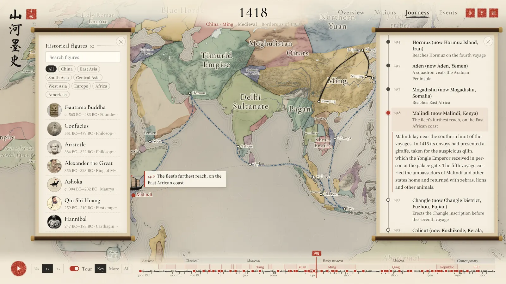
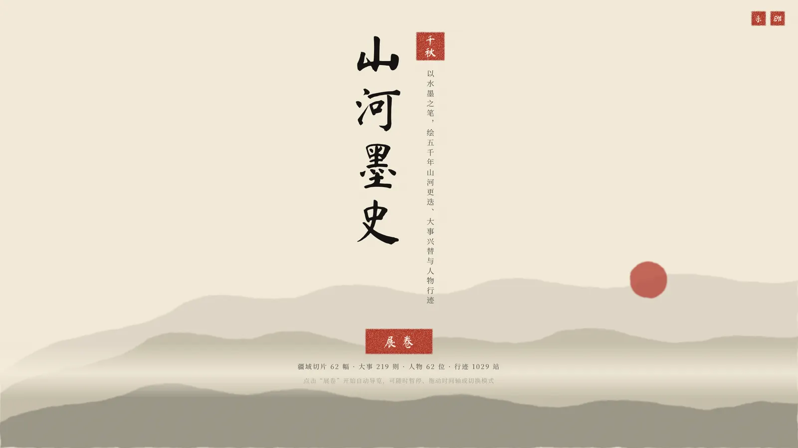
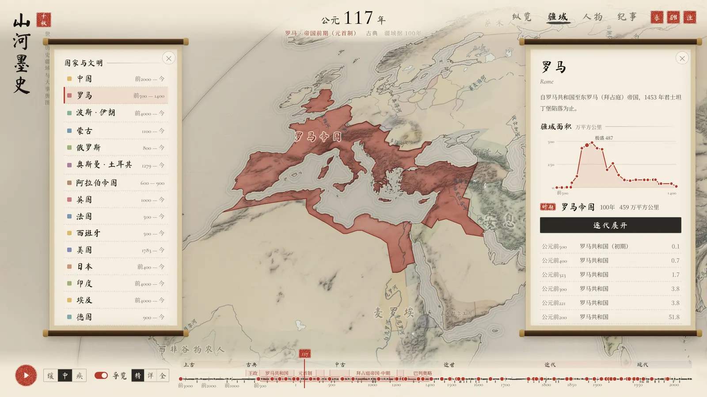
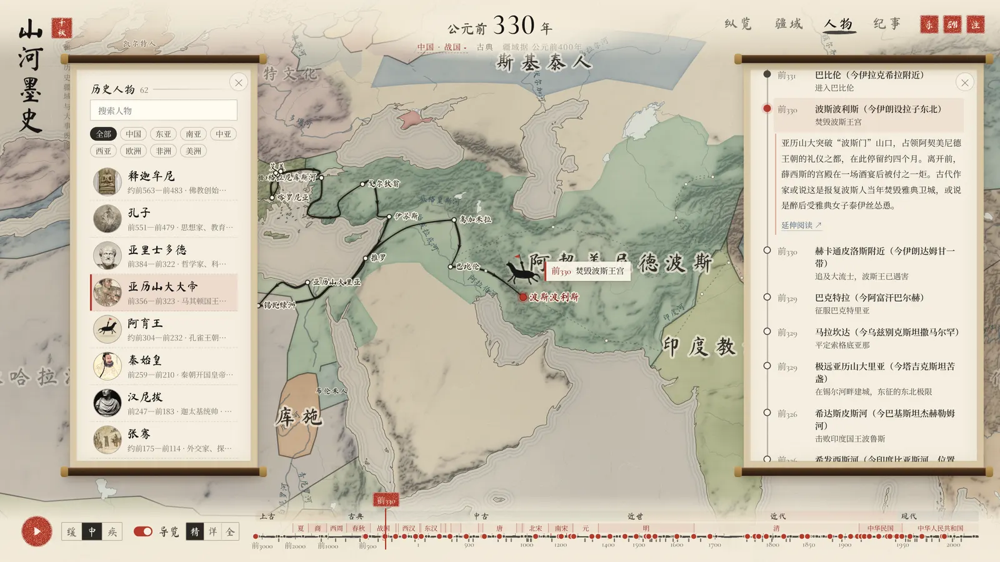
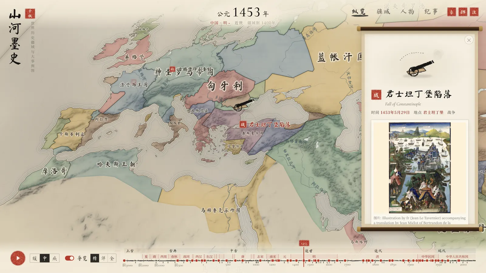

<div align="center">

# Shanhe Ink Atlas · 山河墨史

**5,000 years of empires, events and journeys — painted in ink and wash**

*以水墨之笔，绘五千年山河更迭、大事兴替与人物行迹*

[**Live demo**](https://shanhe-ink-atlas.vercel.app/?lang=en) · English · [简体中文](README.md)

[](https://github.com/cheapCoder/shanhe-ink-atlas/actions/workflows/ci.yml)
[](LICENSE)
[](src/locale)
[](https://react.dev)
[](https://vite.dev)
[](https://d3js.org)



</div>

An interactive atlas of world history in the style of Chinese ink-wash painting. From 3200 BCE to the present day, the map plays back the rise and fall of states like a hand scroll being unrolled, pauses at the scene of major events to tell their story, and marks each one with a small animated ink sprite. You can also follow a single nation or civilization through the ages, or trace the lifelong journey of a historical figure. The interface and all content are available in **English and Chinese**.

## Highlights

- 🖌️ **A living scroll painting** — rice-paper texture, watercolour washes, ink-shaded mountains and coastal ripples are all drawn on Canvas, on a Pacific-centred world map.
- 🌏 **Bilingual throughout** — interface, event narration, life journeys, and the names of states and rivers on the map, switchable with one click. Adding a language means adding one more set of strings.
- 🗺️ **Five millennia of borders** — 62 time slices (54 from historical-basemaps, 8 redrawn for key years such as the Qin unification, the Treaty of Shaoxing and the Ming-Qing transition), cross-faded as time flows.
- 📜 **219 events** — the camera flies to each site and pauses for a short narration with images and sources. The tour has three depths (Key, More, All); how long it lingers depends on how much there is to read, and it waits while your pointer is on the card.
- 🧭 **64 lives, 1057 stops** — from Zhang Qian, Xuanzang and Zheng He to Marco Polo, Magellan and Captain Cook. Routes are drawn as curved brush strokes, and every stop tells its story in two or three sentences.
- 🏯 **15 nations and civilizations** — China, Rome, Persia, the Mongols, the Ottomans and more, highlighted in cinnabar with a territory chart. The dynasties on the timeline change with the nation you are looking at.
- 🎵 **Music that follows the map** — no audio files: a plucked-string improvisation synthesised in the browser, whose scale and timbre shift as the camera moves between East Asia, South Asia, West Asia and Europe.
- 🔗 **Shareable views** — the address bar records the year, mode and selection, so a copied link opens the same view.
- 🔍 **Traceable by design** — every border correction records its reason and a Wikipedia source; events and figures are cross-checked against Wikidata.
- ⚡ **Fully static, no backend** — all data is preprocessed into static files. While the camera is flying, the map is drawn from a whole-world bitmap prepared on a background thread instead of re-rendering vectors every frame, so switching nations and flying to events stay smooth.

<table>
  <tr>
    <td width="50%"><p align="center">Opening · unroll the scroll</p></td>
    <td width="50%"><p align="center">Nations · Rome and its chronology</p></td>
  </tr>
  <tr>
    <td width="50%"><p align="center">Journeys · Alexander's campaign</p></td>
    <td width="50%"><p align="center">Overview · 1453, the fall of Constantinople</p></td>
  </tr>
</table>

## Getting started

Requires Node.js 22.18 or later (the data scripts import `.ts` files directly using Node's built-in type stripping).

```bash
npm install
npm run dev        # dev server at http://127.0.0.1:5173
npm run build      # type-check + production build into dist/
npm run preview    # preview the production build
```

`dist/` is a plain static site that can be hosted anywhere. Borders, base maps and images are all preprocessed static files (`public/data`, `public/images`); nothing is fetched from third-party services at runtime.

## How to use

| Mode | What it does |
| --- | --- |
| Overview | Plays back changing borders along the timeline. With *Tour* on, playback flies to events, pauses to narrate, then moves on |
| Nations | Pick a nation or civilization: its core is highlighted in cinnabar, dependencies dashed, with a territory chart and periods in the side panel; the timeline switches to that nation's chronology |
| Journeys | Pick a person: the timeline marks their lifespan, the map draws their route leg by leg with a sprite travelling along it, and the panel narrates each stop |
| Events | All events in chronological order, searchable in either language and filterable by category; click one to fly there |

**Timeline** — world-history eras and the chronology of the nation in view on top (click the nation's name under the year to choose another); time-slice ticks and event marks below. Click or drag to jump to any year. Three playback speeds.

**Tour** — *Key* stops only at turning points, *More* at every major event, *All* at everything; hover a depth to see roughly how long the whole run takes. Dwell time is estimated from the length of the narration, pauses while your pointer is on the card, and can be cut short with *Continue*. Events that follow closely are chained without flying home in between.

**Keyboard** — `Space` play/pause; `←` `→` previous/next event (stop in Journeys mode, period in Nations mode); `Esc` close details or notes.

**Language and music** — the three small seals at the top right are music on/off, language, and data notes. You can also force a language with `?lang=en` or `?lang=zh`.

In dev mode, open `/?sprites` to browse every ink sprite.

## Contributing

Content is the most welcome contribution: a missing event, a richer journey, a corrected date or coordinate, a better translation. Both languages of an entry live in the same place, so one entry is one edit.

```bash
npm run data:lint   # offline check of every event and figure: fields, both languages, dates, coordinates, cross-references
```

See [CONTRIBUTING.md](CONTRIBUTING.md) for the data format and ground rules (the detailed writing guide, in Chinese, is [docs/content-guide.md](docs/content-guide.md)).

## Data sources

| Content | Source | License |
| --- | --- | --- |
| Historical borders | [historical-basemaps](https://github.com/aourednik/historical-basemaps) (André Ourednik) | GPL-3.0 |
| Coastlines, rivers, lakes | [Natural Earth](https://www.naturalearthdata.com/) 1:50m (plus 1:10m historic water bodies) | Public domain |
| Shaded relief | Natural Earth SR_50M | Public domain |
| Disputed areas, South China Sea line | Natural Earth 1:10m disputed areas, boundaries and maritime indicators (China point of view) | Public domain |
| Events and figures | Chinese and English Wikipedia, Wikidata | CC BY-SA 4.0 / CC0 |
| Images | Wikimedia Commons, free-licence or public-domain files only | Credited per image |

Every event and figure lists the Wikipedia articles it draws on at the bottom of its card. The in-app notes panel (the 注 seal) lists all sources, the full correction log and the notes on borders.

## License

- Code, data pipeline and `public/data/borders`: [GPL-3.0](LICENSE)
- Event and figure text: written from Wikipedia, CC BY-SA 4.0
- Images: each keeps its original Wikimedia Commons licence, credited in the app
- Coastlines, rivers, lakes and relief: Natural Earth, public domain

## Data pipeline

Raw data lives in `data_raw/` (not committed). Run these in order to rebuild every static file from scratch:

```bash
npm run data:raw       # download historical-basemaps, Natural Earth vectors and SR_50M relief
npm run data:borders   # borders: clean, correct, redraw, simplify to TopoJSON; write index, areas and correction log
npm run data:base      # base map: land, lakes (modern reservoirs removed), rivers with names, South China Sea line and islands
npm run data:relief    # reproject shaded relief into a 4096×2130 ink mountain texture
npm run data:wiki      # fetch Wikipedia links and Commons images (licence-checked, converted to WebP) for events, figures and journey stops
npm run data:verify    # cross-check dates, coordinates and birthplaces against Wikidata → docs/verify_report.md
npm run data:check     # check ring orientation and abnormal areas in the output slices
npm run data:lint      # offline check of the event and figure content
```

Events and stops added since the last `data:wiki` run have no image yet; their cards still show the text and article links.

The map uses the Natural Earth projection centred on 150°E (Pacific in the middle, edges in the Atlantic). The relief texture and label anchors are precomputed for this projection, so after changing it (keep `src/modules/map_view/engine/projection.ts` and `scripts/lib/geo_ops.mjs` in sync) re-run `data:borders` and `data:relief`.

### Corrections

Some historical-basemaps slices disagree with the accepted record (no Tang dynasty in 700, a misplaced Jin-Southern Song border in 1200, the Qing still shown during the Republic, and so on). `scripts/borders_fixes.mjs` records every fix with its reason and source, in both languages:

- `rename` — fix anachronistic polity names (Sui → Tang in 700, Eastern Jin → Southern Qi in 500, Qing → Republic of China in 1914);
- `merge` / `splitByLine` — merge regions shown separately into their polity, or split along historical boundaries (the Huai River-Dasan Pass line between Southern Song and Jin);
- `borrow` — the source still shows the whole Yuan in 1400, so the 1492 Ming and Joseon outlines are borrowed as an approximation;
- `transfer` — move South Tibet and the disputed areas on the western and middle sectors of the China-India border into China, using Natural Earth's China point-of-view data;
- `synthetic` — new slices for key years missing from the source: Qin unification (221 BCE), Treaty of Shaoxing (1142), rise of the Mongols (1206), fall of the Jin (1234), early Ming (1368), Ming-Qing transition (1644), Republic of China (1912), People's Republic of China (1949).

## How it works

- **Map engine** (`src/modules/map_view/engine`) — at rest the map shows crisp layers rendered for the current view (paper, base map, polity washes, water, highlight and labels, each cached). As soon as the camera moves, it switches to a whole-world proxy bitmap prepared on a background thread: each frame just places that bitmap at the current view, and the crisp layers are redrawn and faded back in once the camera settles. Flight smoothness therefore does not depend on how many polities or how much coastline is in view.
- **Journeys** (`src/modules/figure_route`) — each leg is drawn as an arc, so outbound and return trips along the same road separate naturally; sea legs with intermediate points run through them as a smooth spline.
- **Music** (`src/modules/sound`) — Karplus-Strong plucked strings, a flute and a drone synthesised with Web Audio; no audio files.
- **Languages** (`src/locale`) — interface strings are one file per language; content data keeps both languages side by side and `tx()` picks the current one.

## Project structure

```
scripts/                 data pipeline (download, borders, base map, relief, Wikipedia, verification)
public/data/borders      time-slice TopoJSON, index, area table, correction log
public/data/base         land, lakes, rivers, relief texture, South China Sea layer
public/images            images for events, figures and journey stops (WebP)
src/data                 events, journeys, lineages, per-nation chronologies, names of polities and places, sources
src/locale               interface strings (Chinese, English)
src/store                global state (zustand)
src/modules/map_view     Canvas ink-wash map engine: projection, paper, base map, colouring, labels, layer cache, proxy bitmaps
src/modules/…            timeline, playback and tour, detail cards, panels, territory, journeys, music, share links, sprites, intro, notes
docs/content-guide.md    content writing guide (Chinese)
```

## Notes on borders

- Historical borders are scholarly reconstructions; most boundaries are approximate, and changes jump between time slices rather than varying year by year.
- Tibet from the Yuan dynasty on and Taiwan from the Qing dynasty on are shown within the territory of the central government of the time; Outer Mongolia during the Republic of China is shown according to its legal status before 1946. South Tibet and the disputed areas on the western and middle sectors of the China-India border are shown as part of China; slices from 1949 on include the South China Sea dashed line and islands. Every such decision is recorded in the correction log.
- This is an illustrative map, not a standard map, and must not be used as a basis for delimiting boundaries.
