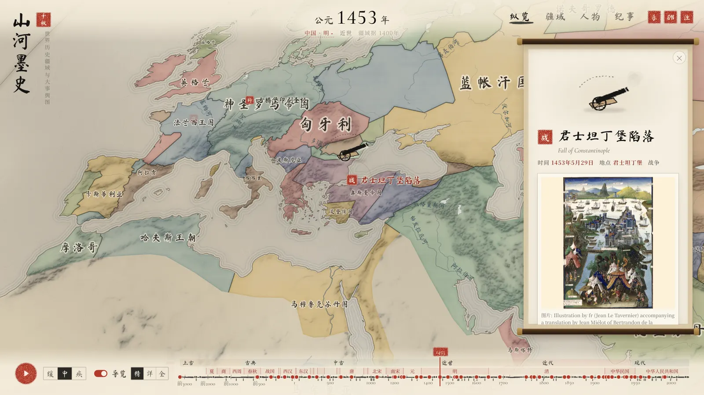
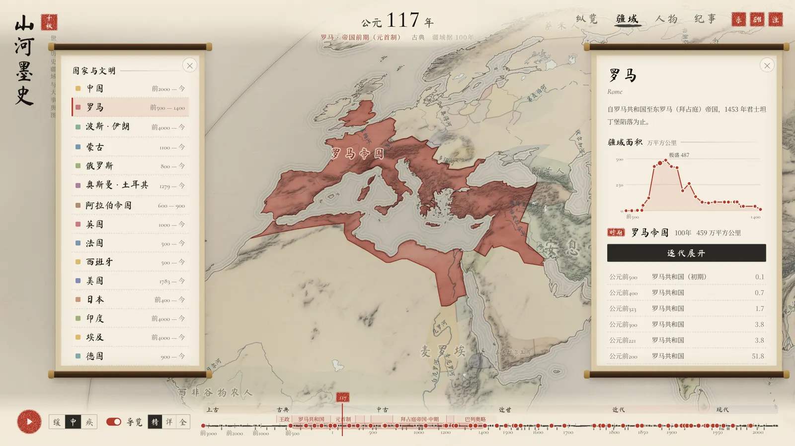
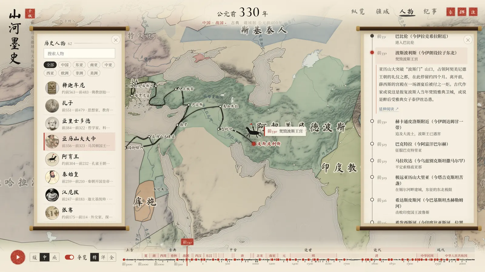

<div align="center">

# 山河墨史 · Shanhe Ink Atlas

**以水墨之笔，绘五千年山河更迭、大事兴替与人物行迹**

*An ink-wash atlas of world history — 5,000 years of empires, events and journeys, unrolled like a Chinese scroll painting.*

[**在线体验**](https://shanhe-ink-atlas.vercel.app) · [English](README.en.md) · 简体中文

[](LICENSE)
[](https://react.dev)
[](https://vite.dev)
[](https://d3js.org)



</div>

水墨风格的世界历史疆域与大事件交互地图。从公元前 3000 年到当代，沿一条历史长卷自动播放各国疆域的消长，在大事发生地停驻讲解，并以水墨小动画点出事件的典型人物或器物；可单独查看一个国家或文明的历代疆域，也可追寻历史人物一生的行迹。

## 亮点

- 🖌️ **一幅会动的长卷**：宣纸纹理、淡彩晕染、墨色山体与近岸水纹全部由 Canvas 绘制，太平洋居中的世界地图像国画一样徐徐展开。
- 🗺️ **五千年疆域**：62 幅年代切片（54 幅来自 historical-basemaps，8 幅为秦统一、绍兴和议、明清易代等关键年份补绘），切片之间淡入淡出。
- 📜 **78 则大事**：飞往发生地停驻讲解，配图、出处齐全，并以水墨小精灵点出典型人物或器物。
- 🧭 **56 位人物、556 个生平站点**：从张骞、玄奘、郑和到马可·波罗、麦哲伦，按大圆航线逐段画出一生行迹。
- 🏯 **15 个国家与文明谱系**：中国、罗马、波斯、蒙古、奥斯曼……朱色突出本部，附疆域面积曲线与分期。
- 🔍 **处处可追溯**：每一处校勘都写明理由与维基出处，大事与人物逐条和 Wikidata 比对。
- ⚡ **纯静态、零后端**：全部数据预处理为静态文件，多级细节（LOD）与 Web Worker 解码让缩放飞行保持流畅。

<table>
  <tr>
    <td width="50%"><p align="center">开场 · 展卷</p></td>
    <td width="50%"><p align="center">疆域 · 中国历代疆域与面积曲线</p></td>
  </tr>
  <tr>
    <td width="50%"><p align="center">人物 · 郑和七下西洋</p></td>
    <td width="50%"><p align="center">纵览 · 1279 年，元灭南宋</p></td>
  </tr>
</table>

> 在线体验部署在 Vercel，`*.vercel.app` 在中国大陆访问可能不稳定，可本地运行或自行部署到其他静态托管。

## 运行

需要 Node.js 22.18 或更高版本（数据脚本直接导入 `.ts` 数据文件，依赖 Node 内置的类型擦除）。

```bash
npm install
npm run dev        # 开发服务器 http://127.0.0.1:5173
npm run build      # 类型检查 + 生产构建到 dist/
npm run preview    # 预览生产构建
```

`dist/` 是纯静态站点，可直接部署到任意静态托管。疆域、底图与配图都是预处理好的静态文件（`public/data`、`public/images`），运行时不请求第三方服务。

## 使用

| 模式 | 说明 |
| --- | --- |
| 纵览 | 沿时间轴自动播放疆域变迁。打开「导览」后，播放到重要大事会飞往发生地、停驻讲解，再继续前行 |
| 疆域 | 选一个国家或文明：地图上以朱色突出其本部、以虚线标出附属，侧栏给出疆域面积曲线和分期 |
| 人物 | 选一位人物：时间轴标出生卒区间，地图上按年份逐段画出行迹，行进中的精灵随路线移动 |
| 纪事 | 全部大事按年代排列，可按关键字检索、按类别筛选，点选即飞往发生地 |

时间轴：上方是世界史分期和中国朝代，下方是年代切片刻度（虚点为补绘切片）与大事印记，点选或拖动可以跳到任意年份；播放速度分缓、中、疾三档，全程「中」速约 6 分钟。

快捷键：`空格` 播放或暂停；`←` `→` 切换上一个或下一个大事（人物模式切换行迹站点，疆域模式切换时期）；`Esc` 收起详情或数据说明。

开发模式下访问 `/?sprites` 可查看全部水墨动画精灵。

## 数据来源

| 内容 | 来源 | 许可 |
| --- | --- | --- |
| 历史疆域 | [historical-basemaps](https://github.com/aourednik/historical-basemaps)（André Ourednik） | GPL-3.0 |
| 海岸、河流、湖泊 | [Natural Earth](https://www.naturalearthdata.com/) 1:50m（另用 1:10m 历史水域） | 公有领域 |
| 山体晕渲 | Natural Earth SR_50M 晕渲地形 | 公有领域 |
| 争议地区、南海断续线 | Natural Earth 1:10m 争议地区、国界与海上界线指示（中国视角） | 公有领域 |
| 大事与人物 | 中文、英文维基百科，Wikidata | CC BY-SA 4.0 / CC0 |
| 配图 | Wikimedia Commons，仅取自由许可或公有领域文件 | 逐图注明作者与许可 |

每则大事、每位人物都在详情卡底部列出所依据的维基条目；应用内「注」按钮打开的数据说明列出全部来源、校勘记录和合规说明。

`public/data/borders` 由 historical-basemaps 加工而来，按 GPL-3.0 再分发时须同样以 GPL-3.0 提供这些数据及其加工脚本。

## 许可

- 代码、数据流水线与 `public/data/borders`：[GPL-3.0](LICENSE)
- 大事与人物的文字摘要：源自维基百科，CC BY-SA 4.0
- 配图：沿用各文件在 Wikimedia Commons 上的原许可，作者与许可见详情卡和应用内数据说明
- 海岸、河流、湖泊与山体晕渲：Natural Earth，公有领域

## 数据流水线

原始数据放在 `data_raw/`（不入库），依次执行即可从零重建全部静态数据：

```bash
npm run data:raw       # 下载 historical-basemaps、Natural Earth 矢量与 SR_50M 晕渲
npm run data:borders   # 疆域：清理、校勘、补绘、简化为 TopoJSON，输出切片索引、面积表、校勘记录
npm run data:base      # 底图：陆地、湖泊（剔除现代水库）、河流及中文河名，南海断续线与南海诸岛
npm run data:relief    # 晕渲地形重投影为 4096×2130 的墨色山体纹理
npm run data:wiki      # 拉取维基摘要、条目链接与 Commons 配图（校验许可后转 WebP）
npm run data:verify    # 与 Wikidata 的时间、坐标、生卒地逐条比对，生成 docs/verify_report.md
npm run data:check     # 检查输出切片的环方向与异常面积
```

维基与 Wikidata 的响应缓存在 `data_raw/wiki_cache`、`data_raw/wikidata_cache`，重跑不会重复请求。

地图采用自然地球投影，中央经线为东经 150°（太平洋居中，左右边缘落在大西洋）。山体纹理和政权标注锚点都按这一投影预先算好，修改投影（`src/modules/map_view/engine/projection.ts` 与 `scripts/lib/geo_ops.mjs` 须同步）后要重跑 `data:borders` 和 `data:relief`。

### 校勘与补绘

historical-basemaps 的部分切片与通行史实不符（如 700 年没有唐朝、1200 年的金与南宋边界错位、民国时期仍标为清朝等）。`scripts/borders_fixes.mjs` 记录了全部修正，每条都写明原因和依据的条目：

- `rename`：改正年代错置的政权名称，例如原数据 700 年仍标为隋（改为唐）、500 年仍标为东晋（改为南齐）、1914 年仍标为清（改为中华民国）；
- `merge` / `splitByLine`：把被单列的地区并入所属政权（如元以后的西藏、民国时期的新疆与东北），或沿历史分界线切分（如按绍兴和议的淮河—大散关一线分出南宋与金）；
- `borrow`：原数据 1400 年仍是元朝全境，借用 1492 年的明朝、朝鲜轮廓作为近似；
- `transfer`：原数据把藏南地区及中印边界西段、中段的争议地区划给阿萨姆、英属印度或印度，按 Natural Earth 中国视角的争议地区与国界数据划归中国；
- `synthetic`：在原数据缺失的关键年份补绘切片——秦统一（前 221）、绍兴和议（1142）、蒙古兴起（1206）、金亡（1234）、明初（1368）、明清易代（1644）、民国（1912）、新中国（1949）。

地图上的政权名称由 `src/data/polityNames.ts` 统一译为中文，并按当前年份修正同一切片内的朝代称谓（例如 630 年显示「唐」，1150 年显示南宋、金、西夏、西辽）。

### 数据校验

`docs/verify_report.md` 列出本项目与 Wikidata 不一致的字段。差异不等于错误：Wikidata 的事件条目常记录战役开始日、条约生效日、儒略历日期或所在国家的中心坐标，报告中现存的差异均已逐条复核，属于上述口径不同。

## 目录

```
scripts/                 数据流水线（下载、疆域加工、底图、晕渲、维基、校验）
public/data/borders      年代切片 TopoJSON、索引、面积表、校勘记录
public/data/base         陆地、湖泊、河流、晕渲纹理
public/images            事件与人物配图（WebP 原图与缩略图）
src/data                 大事、人物行迹、国家谱系、纪年、政权译名、数据来源
src/locale               界面文案
src/store                全局状态（zustand）
src/modules/map_view     Canvas 水墨地图引擎：投影、宣纸、底图、着色、标注、图层缓存
src/modules/…            时间轴、播放与导览、详情卡、侧栏、疆域、人物路线、动画精灵、开场、数据说明
```

## 合规说明

- 历史疆域是学术复原，边界多为近似，且切片之间的变化按年代跳变而非逐年连续。
- 西藏自元代起、台湾自清代起均按历代中央政府版图表示（1945 年以后的台湾依一个中国原则并入中国）；民国时期的外蒙古按 1946 年中华民国承认其独立之前的法理地位并入中华民国。每条处理都记在校勘记录里，并注明史学界的不同看法。
- 藏南地区及中印边界西段、中段的争议地区，自 1815 年切片起按中国政府立场并入中国，范围取 Natural Earth 中国视角的争议地区与国界数据；1949 年以后的切片绘出南海断续线（Natural Earth 中国视角海上界线）、南海诸岛与钓鱼岛。
- 疆域线取自开放数据，与我国标准地图仍可能存在差异，**本图为示意图，不能视为标准地图**。
- 本项目为个人非商业的示意性作品，未经地图审核。在中国境内正式出版或商业展示含国界线的地图，须依法送审并标注审图号，或改用自然资源部标准地图服务提供的底图。
